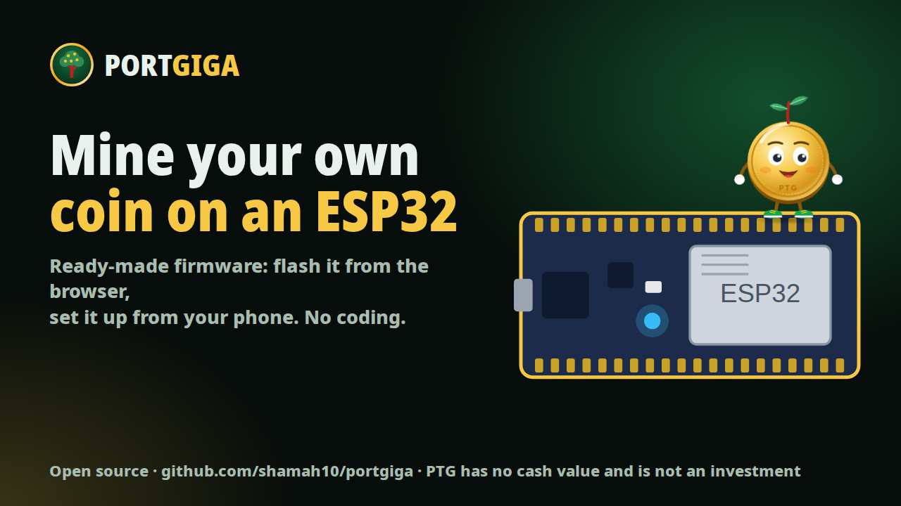
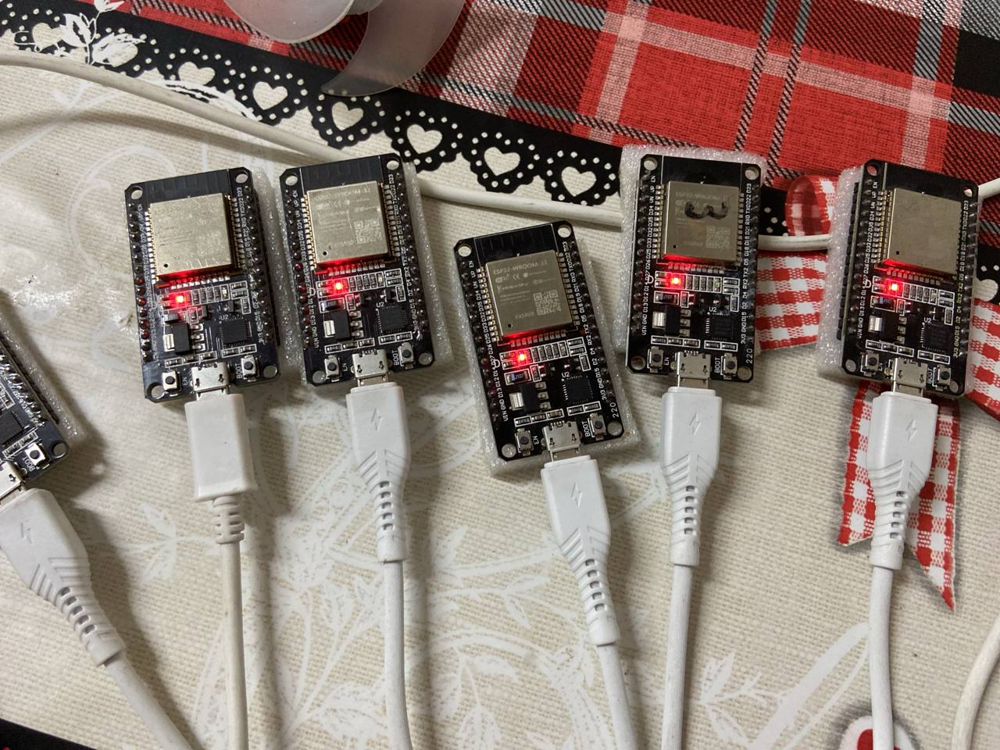
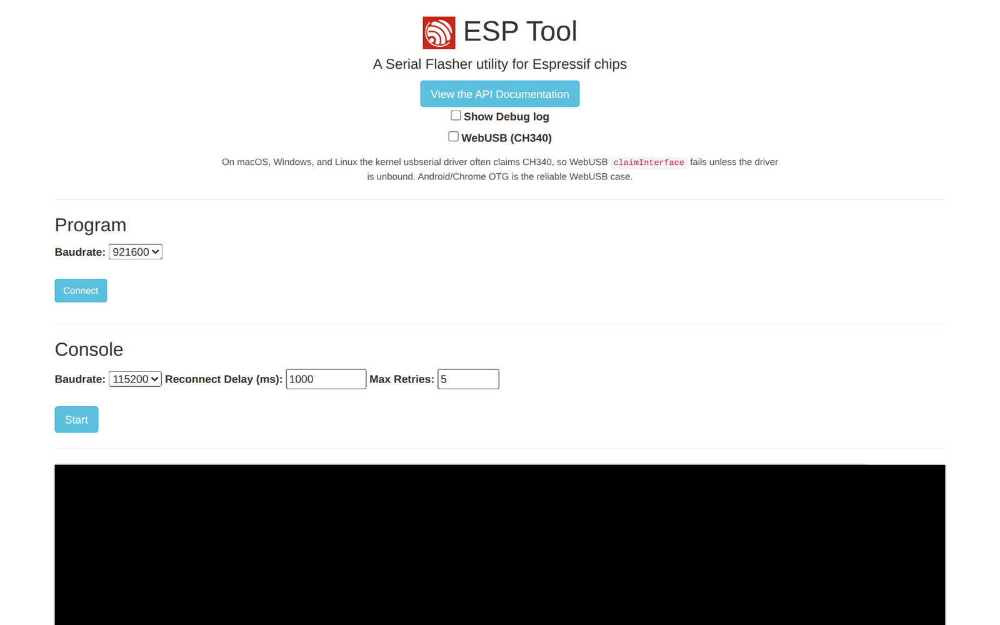
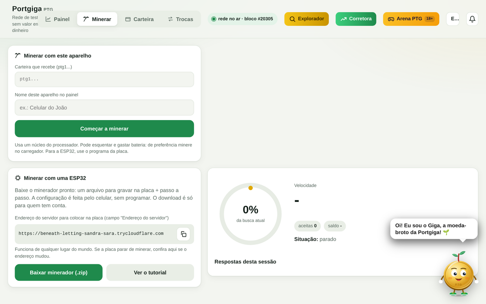
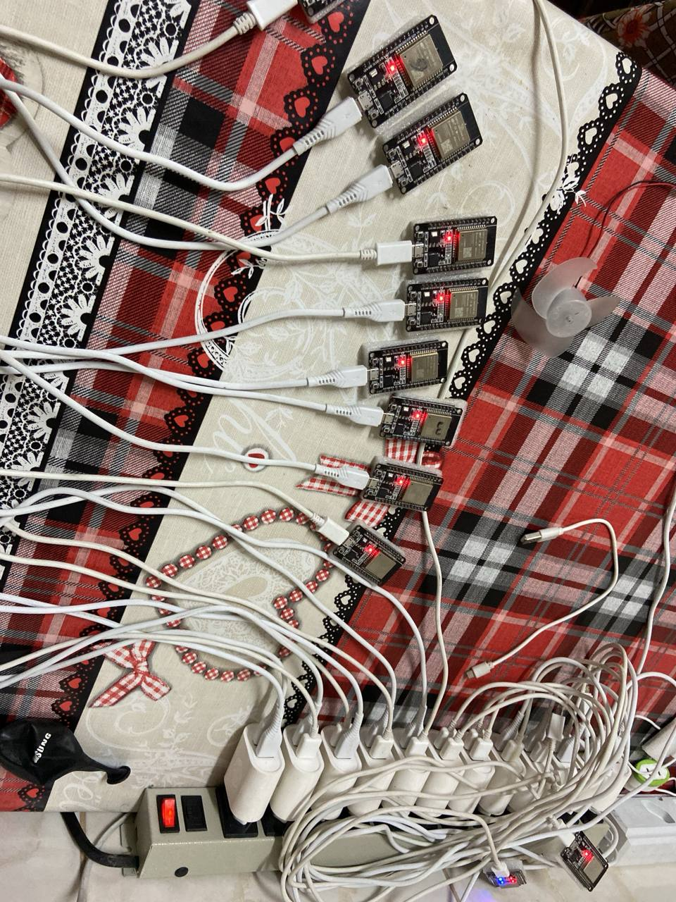
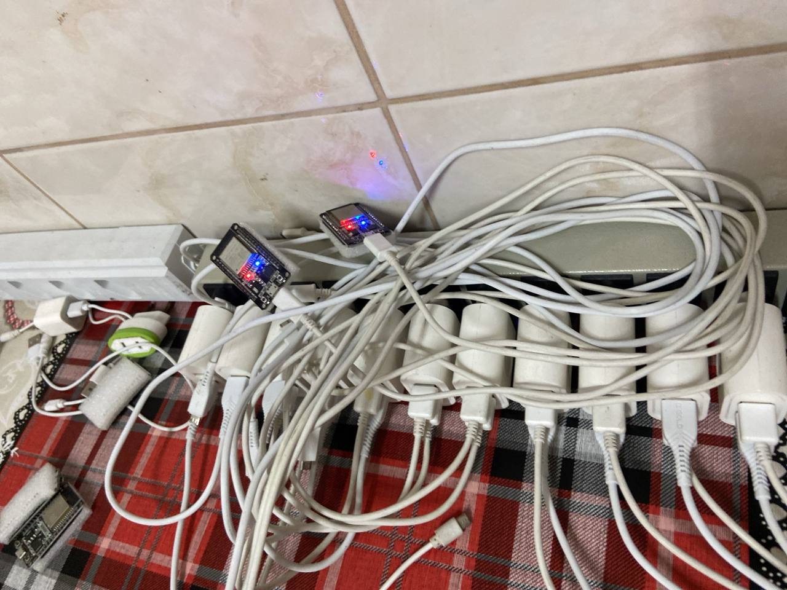
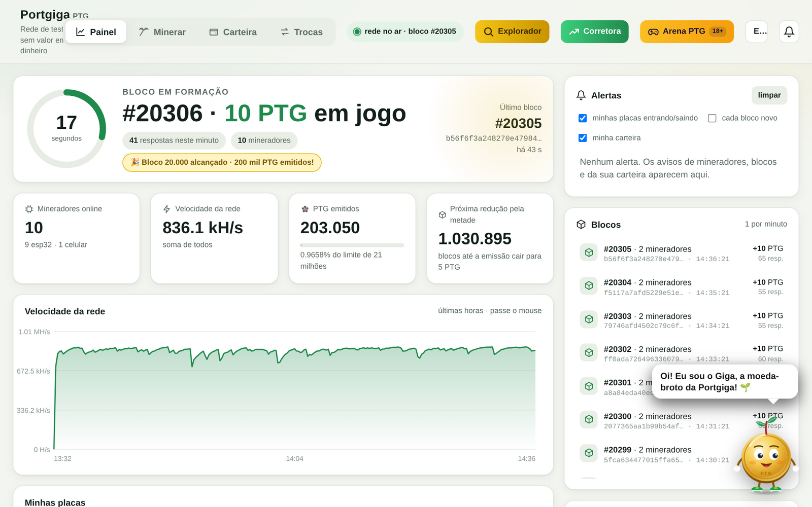

# Mine your own coin on an ESP32 (no coding needed)



It started with a silly question: **can a cheap ESP32 board mine a coin on equal terms with a computer?** With Bitcoin that's impossible: whoever has the biggest machine takes everything.

The answer became **Portgiga (PTG)**, a small Brazilian peer-to-peer exchange coin with the pau-brasil tree as its symbol. Nine ESP32 boards mine it on my desk, and block 20,000 came out on Nov 24, 2026. In this guide you flash the miner onto an ESP32 in about 10 minutes from your browser and set it up from your phone.



> **First things first:** Portgiga is a learning project in a test phase. **PTG has no cash value and is not an investment.** Nobody promises profit. It's a coin for trading between people, made for fun. The web interface is in Portuguese for now; the steps below tell you what to click.

## How a tiny board can compete with a computer

The server sends each device a challenge: find a number `n` such that `sha256(base + n)` hits a target. The trick is the **size of the challenge**: every device gets a range sized so it answers roughly every 10 seconds.

- An ESP32 does tens of thousands of hashes per second.
- A phone does over a million.
- Both still earn about the same, because each one solves a challenge sized for it.

Every minute a block of **10 PTG** is split among everyone who answered in that minute. The supply is capped at a little over 21 million PTG, and the reward halves at block 1,051,200. The idea was inspired by [Duino-Coin](https://github.com/duino-coin/duino-coin), which pioneered mining on microcontrollers; Portgiga is its own implementation.

## What you need

| Item | Notes |
|---|---|
| ESP32 board | any common "ESP32 DevKit" / "ESP32-WROOM-32", 30 or 38 pins |
| USB data cable | some cables only charge; swap it if the PC doesn't see the board |
| Computer with Chrome or Edge | Windows, Mac or Linux (Firefox and Safari can't flash) |
| 2.4 GHz Wi-Fi | the ESP32 can't join 5 GHz networks |
| A phone | to configure the board |
| The firmware | [portgiga-minerador-esp32-v1.5.bin](https://github.com/shamah10/portgiga/releases/download/v1.5/portgiga-minerador-esp32-v1.5.bin) ([release page](https://github.com/shamah10/portgiga/releases/tag/v1.5)) |

## Step 1 — Create a free wallet

This is where the coins your board mines will land.

1. Open **https://portgiga.pages.dev** and tap **Carteira** (Wallet).
2. Tap **Criar carteira nova** (Create new wallet).
3. **Write down the secret key** somewhere safe. Whoever has it controls your coins; lose it and you lose the wallet.
4. Copy the **address** starting with `ptg1`. That's the only thing the board needs.

> **Never** put your secret key on the board or send it to anyone.

## Step 2 — Flash the firmware from your browser

**Easiest way:** open **https://portgiga.pages.dev/gravar/** in Chrome or Edge, click **Gravar na placa** (Flash the board), pick the port and wait. Then skip to Step 3. Prefer to do it by hand? Follow the steps below.

1. Plug the ESP32 into your computer.
2. In **Chrome or Edge**, open Espressif's official web flasher: **https://espressif.github.io/esptool-js/**
3. Set **Baudrate** to **460800**, click **Connect** and pick the board's port (usually **CP2102**, **CH340** or **USB Serial**). Stuck on "Connecting..."? **Hold the BOOT button.**
4. Click **Erase Flash** and wait.
5. Set **Flash Address** to **0x0** and choose `portgiga-minerador-esp32-v1.5.bin`.
6. Click **Program** and wait for 100%.
7. Click **Disconnect** and press the board's **EN**/**RST** button.



Port not showing on Windows? Install the USB driver for the chip next to the USB connector: **CP2102** → Silicon Labs "CP210x"; **CH340** → "CH340/CH341".

Prefer the terminal?
```bash
pip install esptool
esptool --chip esp32 erase-flash
esptool --chip esp32 --baud 460800 write-flash 0x0 portgiga-minerador-esp32-v1.5.bin
```

## Step 3 — Set it up from your phone

On first boot the board enters **setup mode**: the blue LED **double-blinks** repeatedly.

1. On your phone, join the Wi-Fi network **Portgiga-xxxxxx** (no password the first time).
2. The setup page opens by itself; if not, browse to **192.168.4.1**.
3. Fill in (the page is in Portuguese):

| Field | What to enter |
|---|---|
| Rede Wi-Fi | your 2.4 GHz Wi-Fi |
| Senha do Wi-Fi | its password |
| Senha da placa (board password) | create one, 8–32 characters, and **write it down**. Nobody on your network can change your wallet without it |
| Carteira (wallet) | your `ptg1...` address |
| Nome do minerador | a name shown on the dashboard |
| Servidor (server) | copy it from the network dashboard, **Minerar** tab, **Minerar com uma ESP32** card (copy button) |

4. Tap **Salvar e começar a minerar** (Save and start mining). The board reboots and joins your Wi-Fi.



> Until the network has its own domain, the server address can change. Since v1.5 the board finds the new address by itself (it reads it from portgiga.pages.dev) and keeps mining.

## Step 4 — Check it's mining

| The blue LED is... | Meaning |
|---|---|
| giving short blinks now and then | mining (each blink = an accepted answer) |
| solid on | connecting to Wi-Fi |
| blinking slowly | can't reach the server: check the address |
| double-blinking | setup mode |

Your board shows up on the dashboard with its speed, accepted answers and a **proof of work** you can verify. Coins arrive every block (one per minute). If power or Wi-Fi drops, the board keeps its settings and comes back on its own.

My setup: nine boards in a row, each on an ordinary phone charger plugged into a power strip.







## Everything is verifiable and open source

Every transfer is signed by the wallet's key and every block stores the hash of the previous one. The explorer shows the network live, and anyone can download the chain and verify it.

- Source code (MIT): **https://github.com/shamah10/portgiga**
- ESP32 firmware: `minerador-esp32/` · server, wallet, exchange and explorer: `servidor/`

Issues and pull requests are welcome.

---
*PTG has no cash value and is not an investment. It's a peer-to-peer exchange coin made for fun and learning.*
