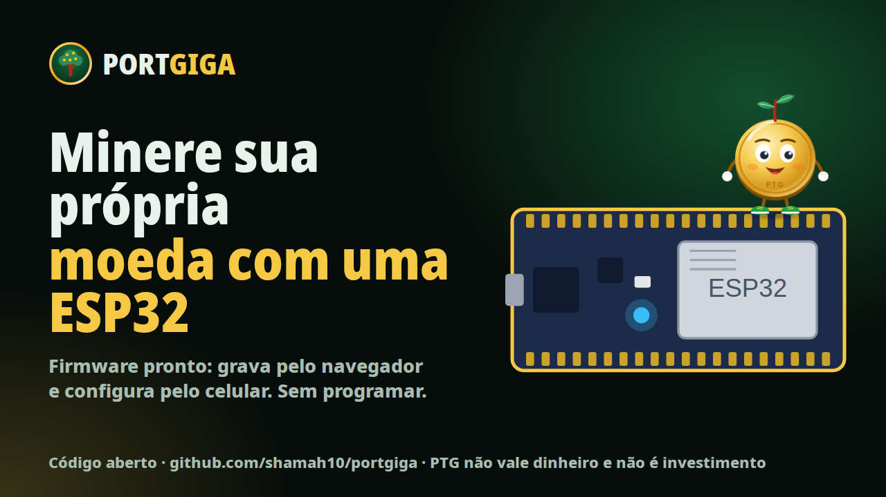
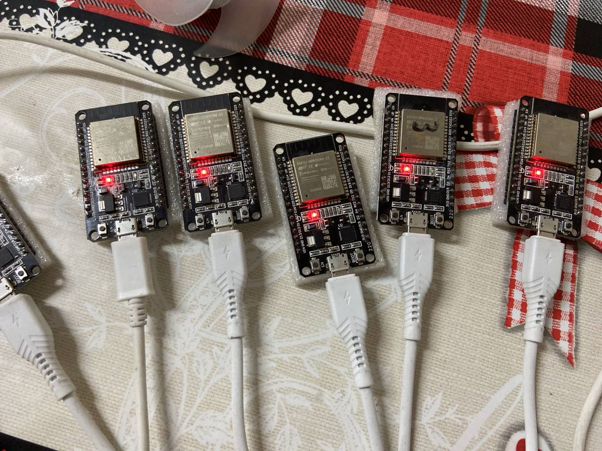
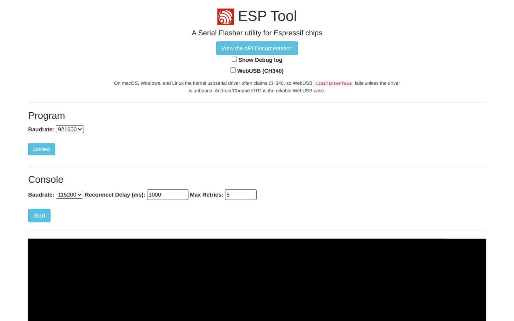
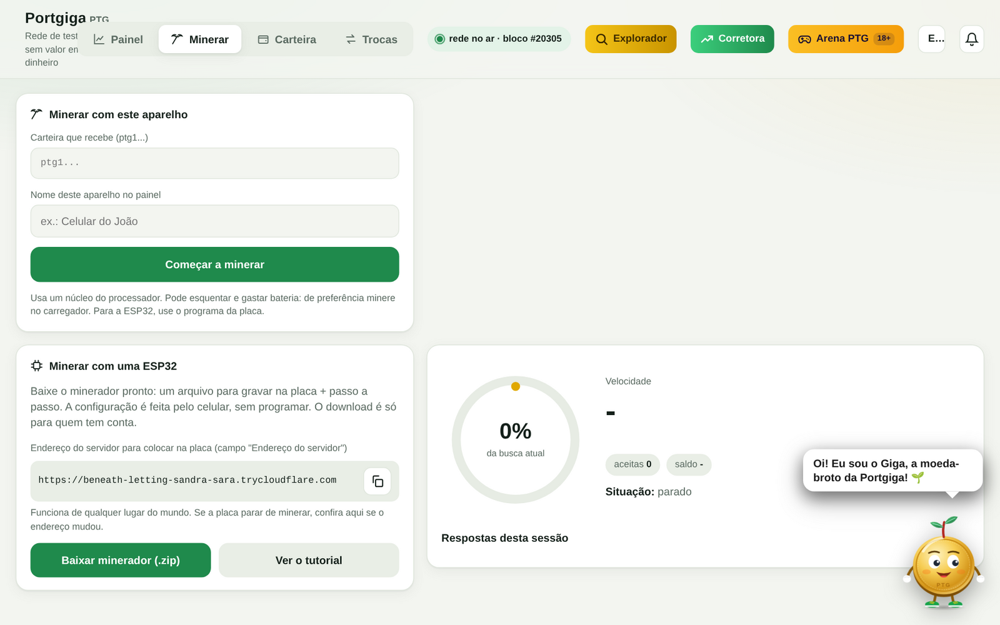
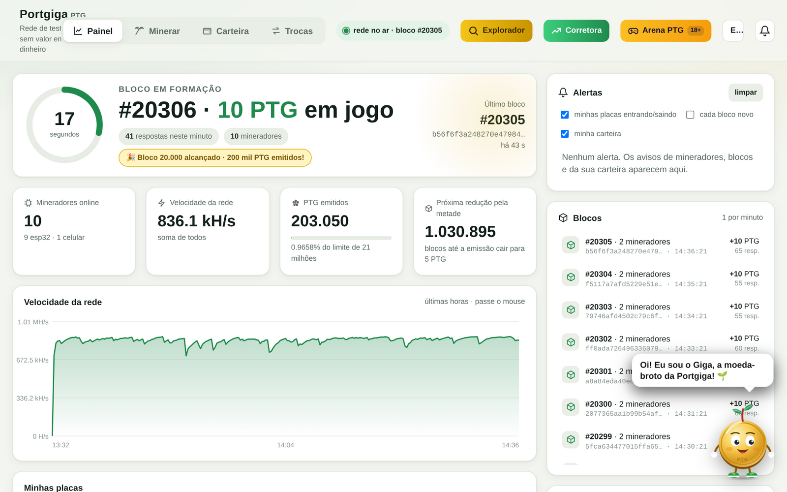
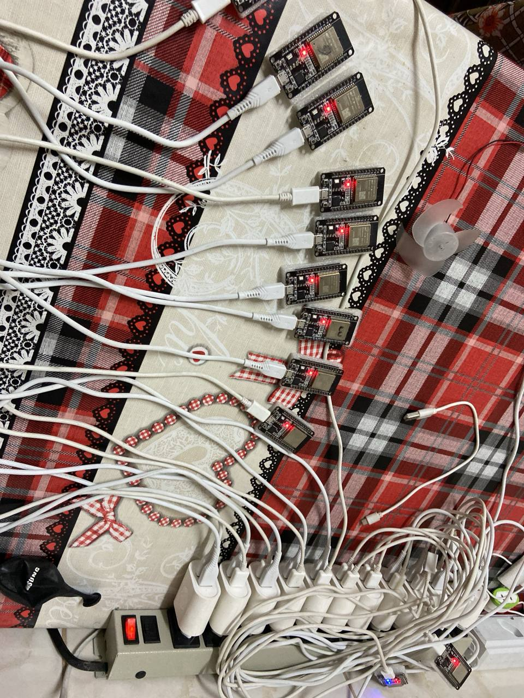
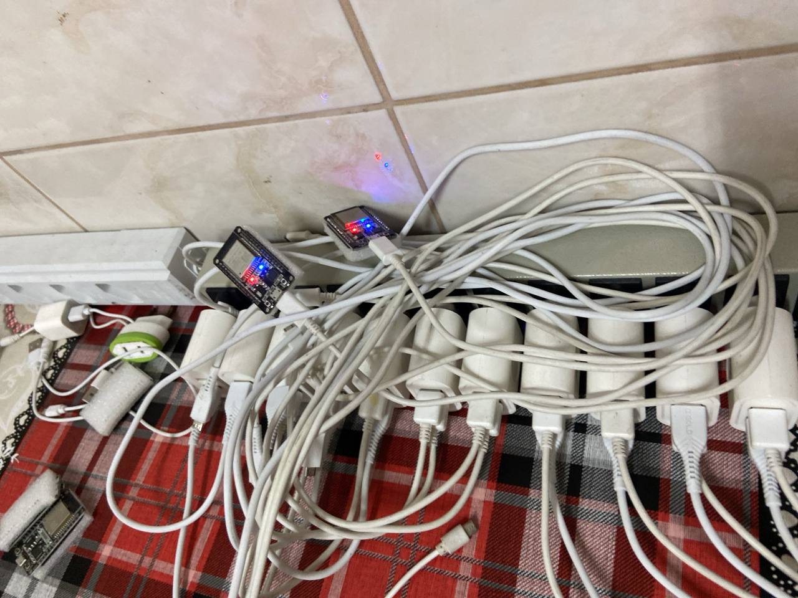
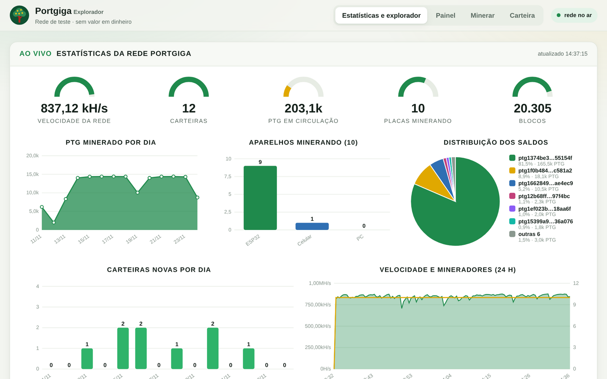

# Minere sua própria moeda com uma ESP32 (sem programar nada)



Comecei com uma pergunta boba: **dá pra fazer uma moeda que uma plaquinha ESP32 minere de igual pra igual com um computador?** No Bitcoin isso é impossível: quem tem máquina gigante leva tudo.

O resultado é a **Portgiga (PTG)**, uma moeda de troca brasileira, com o pau-brasil de símbolo. Hoje tem 9 placas ESP32 minerando na minha mesa, e o bloco 20.000 saiu em 24/11/2026. Neste tutorial você grava o minerador numa ESP32 em uns 10 minutos, pelo navegador, e configura pelo celular.



> **Antes de tudo:** a Portgiga é um projeto de aprendizado em fase de teste. **PTG não vale dinheiro e não é investimento.** Ninguém promete lucro. É moeda de troca entre pessoas, feita por diversão.

## Como a placa consegue competir com um computador

O servidor manda um desafio para cada aparelho: achar um número `n` tal que `sha256(base + n)` dê um resultado específico. O truque é o **tamanho do desafio**: cada aparelho recebe um intervalo do tamanho certo para responder mais ou menos a cada 10 segundos.

- Uma ESP32 faz na casa de **dezenas de milhares** de hashes por segundo.
- Um celular faz **mais de um milhão**.
- Mesmo assim, os dois ganham parecido, porque cada um resolve o desafio do seu tamanho.

A cada minuto sai um bloco com **10 PTG**, dividido entre quem respondeu naquele minuto. O teto é de pouco mais de 21 milhões de PTG, e a emissão cai pela metade no bloco 1.051.200. A ideia veio da [Duino-Coin](https://github.com/duino-coin/duino-coin), que faz mineração com microcontroladores. A Portgiga é uma implementação própria.

## O que você precisa

| Item | Detalhe |
|---|---|
| Placa ESP32 | comum: "ESP32 DevKit", "ESP32-WROOM-32", de 30 ou 38 pinos |
| Cabo USB de dados | alguns cabos só carregam; se o PC não reconhecer, troque o cabo |
| Computador com Chrome ou Edge | Windows, Mac ou Linux (Firefox e Safari não gravam) |
| Wi-Fi de 2,4 GHz | a ESP32 não conecta em 5 GHz |
| Um celular | para configurar a placa |
| O firmware | [portgiga-minerador-esp32-v1.4.bin](https://github.com/shamah10/portgiga/releases/download/v1.4/portgiga-minerador-esp32-v1.4.bin) (página da versão: [releases/v1.4](https://github.com/shamah10/portgiga/releases/tag/v1.4)) |

## Passo 1 — Crie uma carteira (grátis)

É nela que caem as moedas que a placa minerar.

1. Abra **https://portgiga.pages.dev** e toque em **Carteira**.
2. Toque em **Criar carteira nova**.
3. **Anote a chave secreta** num lugar seguro. Quem tem essa chave move as suas moedas; se você perder, perde a carteira.
4. Copie o **endereço**, que começa com `ptg1`. É só ele que vai na placa.


> **Nunca** coloque a chave secreta na placa nem mande para ninguém. A placa só precisa do endereço `ptg1...`.

## Passo 2 — Grave o firmware pelo navegador

1. Ligue a ESP32 no computador pelo cabo USB.
2. No **Chrome ou Edge**, abra o gravador oficial da Espressif (fabricante da ESP32): **https://espressif.github.io/esptool-js/**
3. Em **Baudrate** escolha **460800** e clique em **Connect**. Escolha a porta da placa (costuma aparecer como **CP2102**, **CH340** ou **USB Serial**).
   - Ficou parado em "Connecting..."? **Segure o botão BOOT** da placa até começar.
4. Clique em **Erase Flash** e espere terminar.
5. Em **Flash Address** escreva **0x0** e escolha o arquivo `portgiga-minerador-esp32-v1.4.bin`.
6. Clique em **Program** e espere chegar a 100%.
7. Clique em **Disconnect** e aperte o botão **EN** (ou **RST**) da placa.



**No Windows a porta não aparece?** Falta o driver. Olhe o chip perto do USB da placa: **CP2102** → driver "CP210x" da Silicon Labs; **CH340** → driver "CH340/CH341".

**Prefere o terminal?**
```bash
pip install esptool
esptool --chip esp32 erase-flash
esptool --chip esp32 --baud 460800 write-flash 0x0 portgiga-minerador-esp32-v1.4.bin
```
(Em versões antigas do esptool: `erase_flash` e `write_flash`.)

## Passo 3 — Configure pelo celular

Na primeira vez, a placa entra no **modo configuração**: o LED azul dá **duas piscadas seguidas**, repetindo.

1. No celular, conecte no Wi-Fi **Portgiga-xxxxxx** (sem senha na primeira vez).
2. A página de configuração abre sozinha. Se não abrir, digite **192.168.4.1** no navegador.
3. Preencha:

| Campo | O que colocar |
|---|---|
| Rede Wi-Fi | o seu Wi-Fi de 2,4 GHz |
| Senha do Wi-Fi | a senha dele |
| Senha da placa | crie uma de 8 a 32 caracteres e **anote**. Ela protege a placa: ninguém na sua rede troca a sua carteira sem ela |
| Carteira | o seu endereço `ptg1...` |
| Nome do minerador | como ela aparece no painel, ex.: *Placa do João* |
| Servidor | copie do painel da rede, aba **Minerar**, cartão **Minerar com uma ESP32** (botão de copiar) |

4. Toque em **Salvar e começar a minerar**. A placa reinicia e entra no seu Wi-Fi.



> O endereço do servidor ainda pode mudar enquanto a rede não tem domínio próprio. Se a placa parar de minerar, confira o endereço na aba Minerar e configure de novo.

## Passo 4 — Confira se está minerando

- **Piscada curta de vez em quando** = resposta aceita pelo servidor. É a placa minerando de verdade.
- No painel, aparece um cartão com o nome da placa, a velocidade, as respostas aceitas e a **prova de trabalho**, com um botão **verificar**.
- As moedas caem na carteira a cada bloco (1 por minuto).



| O LED azul está... | Significa |
|---|---|
| dando piscadas curtas de vez em quando | minerando normalmente |
| aceso direto | conectando no Wi-Fi |
| piscando devagar | não está conseguindo falar com o servidor: confira o endereço |
| dando duas piscadas seguidas | modo configuração |

Se faltar luz ou o Wi-Fi cair, a placa não perde a configuração e volta sozinha.

A minha montagem: 9 placas em fila, cada uma num carregador de celular comum, todos num filtro de linha.





## Dá para conferir tudo

Toda transferência é assinada pela chave da carteira, e cada bloco guarda o resumo do anterior. O **explorador** mostra a rede ao vivo, e qualquer um pode baixar a corrente e verificar.



## Código aberto

- Repositório: **https://github.com/shamah10/portgiga** (licença MIT)
- Firmware da ESP32: pasta `minerador-esp32/`
- Servidor, carteira, corretora e explorador: pasta `servidor/`

Ideias, correções e perguntas são bem-vindas nas *issues* do repositório.

---
*PTG não vale dinheiro e não é investimento. É uma moeda de troca entre pessoas, feita por diversão e aprendizado.*
